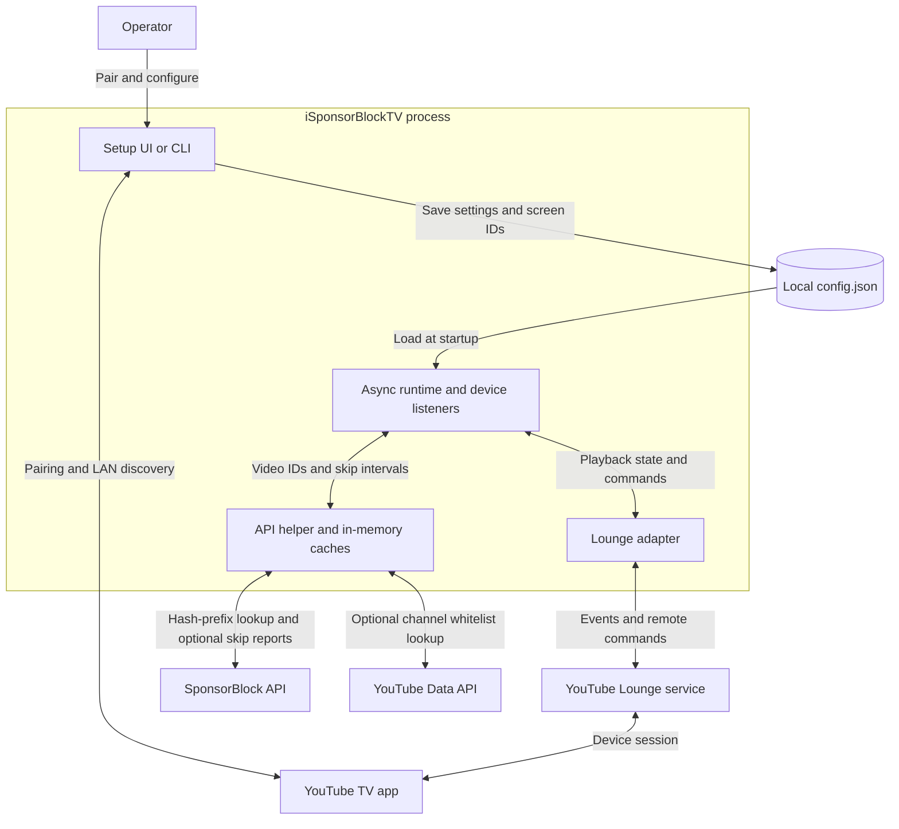

# How iSponsorBlockTV Works

## Purpose and scope

iSponsorBlockTV is a self-hosted remote-control companion for YouTube TV apps.
It watches playback events, looks up unwanted segments, and tells the TV app to
seek past them. It does not download, modify, or proxy the video stream.

Two separate mechanisms are involved:

- **SponsorBlock skipping:** SponsorBlock supplies community-submitted timestamps
  for content embedded in a video, such as sponsor reads, intros, and outros.
  iSponsorBlockTV uses the selected categories to decide where to seek.
- **YouTube ad control:** YouTube Lounge events indicate when an advertisement
  is playing or becomes skippable. The application can mute it or send the
  equivalent of pressing **Skip Ad**. SponsorBlock timestamps do not drive this.

The service description below covers the Python implementation. The separate,
complete native service and its verification boundaries are described in the
[native Rust section](#native-rust-implementation).
For development commands and conventions, see [Repository Guidelines](AGENTS.md).
For supported devices and installation, start with [README.md](README.md).

## System boundary and data flow

The process controls playback through Lounge; video delivery remains between
YouTube and the TV app. The setup-to-TV edge represents local discovery; manual
TV-code pairing also calls YouTube's pairing service through the API helper.
The YouTube Data API is needed for channel whitelist functionality, not ordinary
SponsorBlock segment lookup.

## Components and ownership

All application modules live in `src/iSponsorBlockTV/`.

- **Entry points and configuration — [helpers.py][helpers].**
  `src/main.py` and the installed `iSponsorBlockTV` command reach the same Click
  interface. It selects graphical setup, CLI setup, or service startup.
  `Config` loads/saves JSON and validates runtime settings.
- **Runtime orchestration — [main.py][main].**
  `main_async` owns the event loop's shared HTTP session and connector, creates
  an `ApiHelper`, and starts a listener plus authentication-refresh task for
  each device. Each `DeviceListener` owns its pending playback-processing task.
- **Device protocol — [ytlounge.py][lounge].**
  `YtLoungeApi` subclasses pyytlounge and owns device authentication, mutable
  playback/volume state, playback speed, subscription tasks, and a watchdog.
  A mutex serializes commands to protect upstream command-offset state.
- **External APIs and caching — [api_helpers.py][api].**
  Handles pairing, channel lookups, SponsorBlock requests, segment processing,
  skip-count reporting, and merging discovery results. It receives the shared
  session rather than creating a session for every request.
- **Configuration interfaces — [setup_wizard.py][wizard] and
  [config_setup.py][cli-setup].** The Textual UI and terminal prompts edit the
  configuration. The Textual app owns a separate setup-time HTTP session and
  keeps an initial configuration copy to detect unsaved changes.
- **LAN discovery — [dial_client.py][dial] and
  [chromecast_client.py][cast].** DIAL/SSDP and Chromecast discovery yield device
  records asynchronously. The API helper deduplicates them by screen ID.

These are modules in one Python process, not independently deployed services.
Dependencies are passed through constructors and function arguments; mutable
playback state is isolated per device while API access is shared.

## Pairing and configuration

1. Run the `setup` or `setup-cli` subcommand with a data directory.
2. Add a device using its YouTube TV pairing code or local discovery. Manual
   codes are normalized and exchanged with YouTube for a screen ID.
3. Choose segment categories, ad controls, timing offset, and optional channel
   whitelist settings, then save `config.json`.
4. Start the service. Configuration validation creates runtime `Device` objects
   from saved device dictionaries and checks that devices are present.

Automatic discovery requires LAN access. DIAL first tries to read the running
YouTube app's screen ID; active discovery may launch YouTube with a generated
pairing code if necessary. Passive DIAL discovery does not launch the app.
Normal Lounge operation need not run on the same LAN as the TV.

`--data` selects a **directory**, not a JSON filename. The default comes from
`iSPBTV_data_dir`, then the platform's user-data directory. There is no database:
configuration is persisted as JSON; playback state and caches live in memory.
Runtime settings are loaded at startup, not continuously reloaded from disk.

Important configuration semantics:

- Each device has a screen ID, display name, and optional timing offset.
  Saved offsets are milliseconds; runtime `Device` converts them to seconds.
- Missing `skip_categories` becomes `["sponsor"]`; an explicit `[]` disables
  segment fetching without disabling the separate ad-control features.
- A nonempty channel whitelist requires a YouTube API key. Matching channels
  bypass SponsorBlock skipping, not the independent ad-control logic.
- Missing-key defaults for `mute_ads` and `skip_ads` are false, despite the
  enabled values in `config.json.template`.
- The template contains placeholders and is not ready to run unchanged.
  Setup operates on dictionaries; runtime validation replaces those dictionaries
  with objects, so validated configuration is not the setup persistence model.

## Playback and skipping

### 1. Connect and subscribe

A listener refreshes its Lounge authentication, waits for the TV to become
available, connects, and subscribes to events. A separate loop refreshes auth
approximately every 24 hours. Availability and connection retry paths use
10-second waits.

The adapter translates playback events into `PlaybackState`: video ID, current
position, duration, and playing/paused/stopped state. Playback speed and volume
are maintained separately on the adapter.

### 2. Resolve the video's skip intervals

On a playback callback, the listener cancels its preceding processing task and
starts a replacement using the current state. Segment lookup proceeds as follows:

1. Return no intervals if categories are empty or the channel is whitelisted.
2. Compute SHA-256 of the video ID and send its first four hexadecimal characters
   to SponsorBlock's `skipSegments` endpoint, with the configured categories.
3. Select the matching video from the returned hash-prefix bucket.
4. Merge overlapping segments and intervals less than one second apart, keeping
   their segment UUIDs for optional reporting.
5. Keep processed intervals whose duration is **strictly greater than**
   `minimum_skip_length`.

A processed interval contains `start`, `end`, and a list of `UUID` values. The
adapter also prefetches segments when Lounge announces an upcoming video.

### 3. Schedule and issue a seek

When playback is in the playing state, the listener selects the next eligible
interval. Its delay calculation accounts for the reported position, elapsed
monotonic time since the callback, playback speed, and device offset. A positive
offset advances the seek command to compensate for timing delay.

After the delay, the listener sends a seek to the interval's end and concurrently
invokes skip-count reporting. Reporting posts the interval UUIDs only when
`skip_count_tracking` is enabled. It is not an acknowledgement that the TV
successfully completed the seek.

New playback callbacks replace pending work, allowing pause, seek, and video
changes to reschedule processing instead of relying on a fixed playback timer.
This behavior depends on receiving fresh Lounge events; it is not a hard
real-time timing guarantee.

### 4. Handle ads and autoplay independently

The adapter responds directly to ad events. It sends `skip_ad` when the device
reports that skipping is allowed and `skip_ads` is enabled. Otherwise, with
`mute_ads` enabled, it mutes during ads and restores unmuted playback afterward.
It remembers volume state because Lounge expects volume information when
unmuting. Autoplay-mode events trigger enforcement of the configured preference.

## Cache and resource lifecycle

[conditional_ttl_cache.py][cache] wraps segment lookup with an in-memory LRU
cache of up to 10 entries. Results containing unlocked segments expire after
300 seconds. Results marked `ignore_ttl`, including all-locked results and
whitelist/empty-category bypasses, remain until eviction or process exit.

Non-200 SponsorBlock responses that reach the status-handling branch also cache
an empty result without TTL expiry. JSON decoding or transport failures can take
a different exception path. An empty cached result therefore does not always
mean that a video has no community-submitted segments.

The decorator stores completed results, not in-flight tasks: concurrent misses
can issue duplicate requests. The callable's internal `(value, ignore_ttl)`
return becomes just `value` for callers.

The runtime shares one aiohttp session across devices and API operations.
The setup UI has its own session, closed on unmount. Discovery code owns its
transport/background tasks; Chromecast bridges callbacks into asyncio and
moves blocking inspection work to a thread.

## Failure handling and operational limits

- **Silent connections:** the subscription watchdog checks every 10 seconds.
  After more than 60 seconds without events it cancels the subscription, allowing
  the listener loop to reconnect.
- **Shutdown:** SIGINT/SIGTERM handlers raise `KeyboardInterrupt`; the explicit
  cleanup path disconnects devices and cancels tasks. A `finally` block closes
  the shared HTTP session and connector. Several paths catch `BaseException`,
  so cancellation behavior needs care when modifying lifecycle code.
- **Upstream coupling:** the Lounge adapter uses pyytlounge private fields and
  event handling. Dependency or YouTube protocol changes can affect pairing,
  subscriptions, and command ordering.
- **Device compatibility:** Kids clients are excluded, Shorts support is limited,
  and AirPlay audio routing can prevent ad muting. See README compatibility notes.
  Revoked screen IDs require pairing again.
- **Deployment:** Python 3.11 or newer is required. The Docker image uses Python
  3.13, compiles sources to bytecode, and runs `/app/main.pyc`; persist configuration
  at `/app/data`. Compose uses a published image and requires replacing its
  placeholder host data path.
- **Capacity:** one listener and auth-refresh loop are created per device, plus
  subscription/watchdog and playback tasks. The repository specifies no tested
  device-count limit, availability target, or playback-latency SLA.

## Trust boundaries and privacy

The application makes outbound requests to YouTube services and SponsorBlock.
Local discovery additionally consumes LAN announcements and contacts devices.
In [dial_client.py][dial], advertised device and application URLs must resolve
syntactically to the SSDP sender's literal IP address; redirects are disabled.
Preserve those checks when changing discovery.

Screen IDs and API keys reside in local configuration. Treat that file as
sensitive. The hash-prefix segment lookup avoids sending the full video ID in
that request, but this is not an anonymity guarantee: services still observe
network metadata, and optional skip reports send segment UUIDs. Whitelist
lookups send the video ID and API key to the YouTube Data API.

Proxy environment use is opt-in through `use_proxy`. HTTP tracing can include
response contents; review and redact logs before sharing them.

## Maintenance invariants and verification

These are implementation constraints to preserve, not claims of formal proof:

- **INV-1 — Timing units:** JSON offsets are milliseconds; runtime timing uses
  seconds. Enforced by `Device` conversion and consumed by the skip scheduler.
- **INV-2 — Category intent:** missing and explicitly empty categories differ.
  Enforced by configuration validation and the early return in `get_segments`.
- **INV-3 — Command ordering:** commands for one device pass through its mutex.
  Enforced by the Lounge adapter's `_command` override.
- **INV-4 — Discovery destination:** DIAL URLs stay on the announcing IP, without
  redirects. Enforced by `_url_matches_ip` and individual HTTP request options.
- **INV-5 — State replacement:** a new playback callback cancels preceding
  processing. Enforced by `DeviceListener.__call__`; cancellation-sensitive
  changes require checking that outdated tasks cannot issue later commands.

The Python implementation has no configured automated test suite or coverage threshold.
Existing hooks provide static checks; build workflows do not establish playback
correctness. Validate behavior changes with a dedicated configuration directory
and paired device, especially timing, pause/seek transitions, reconnection,
category bypasses, and shutdown. Discovery verification can affect real devices.

This document is based on source inspection. Its Markdown and diagram can be
validated locally without asserting that a live device session was exercised.

## Native Rust implementation

`rust/` is a separate GPL-3.0-only Rust package, version 2.11.0, pinned to Rust
1.99.1 with a committed dependency lockfile. It implements the service, prompt
setup, full-screen terminal setup, manual pairing, DIAL discovery, and Chromecast
MDX discovery without Python subprocesses or FFI. Python source, entry points,
containers, and releases remain separate and unchanged. The system boundary and
external data flow in the diagram above also apply to the native implementation;
the ownership and failure semantics below replace the Python-specific internals,
not the video-delivery path.

### Composition and ownership

- **`src/main.rs`, `cli.rs`, and `lib.rs`:** a thin executable captures environment,
  signal cancellation, prompt I/O, and production endpoints, then calls
  `run_app(Cli, AppContext)`. Commands are `start` (also the default), `setup`, and
  `setup-cli`. Constructor-supplied endpoints support isolated scenarios; there
  is no shipping endpoint-override flag or test environment variable.
- **`config.rs`:** `ConfigDocument` owns the persisted JSON and setup draft.
  `RuntimeConfig` is a separately validated startup snapshot; no live disk reload
  is performed. `ConfigStore` owns explicit atomic persistence and its saved
  baseline. Captured `Environment` values avoid mutable process-environment
  dependencies in path tests; Windows resolves LocalAppData through the OS
  known-folder API.
- **`http.rs` and `api/*`:** transport policy, pairing, channel lookup/search, and
  SponsorBlock processing are shared by both setup interfaces and service
  composition. Immutable API options scope bounded caches. The direct SponsorBlock
  adapter preserves arbitrary category strings, f64 timestamps, viewed reporting,
  and the common reqwest client policy without a second client library.
- **`runtime/mod.rs`:** the supervisor owns device task handles and cancellation.
  Devices share an immutable runtime configuration and `ApiService`; each
  `DeviceActor` in `runtime/device.rs` exclusively owns its protocol/playback
  state, queues, timers, and child jobs. A slow device does not hold another
  device's control path.
- **`lounge/*`:** the native transport implements authentication, availability,
  bind/subscribe/terminate, typed events, and serialized commands. Incremental
  BrowserChannel decoding counts UTF-16 units in UTF-8 input, validates complete
  envelopes before dispatch, and bounds payload/buffer sizes. It does not
  delegate to pyytlounge.
- **`discovery/*`:** one coordinator owns both backends, candidate admission,
  deduplication, probe slots, deadlines, and the result stream. DIAL uses SSDP
  and bounded XML/HTTP parsing; Cast uses mDNS, local metadata, native TLS,
  length-prefixed protobuf, receiver negotiation, heartbeat, and MDX extraction.
- **`setup/*`:** the prompt interface and Ratatui/Crossterm interface edit the same
  document model and use the same APIs. `state.rs` is a pure reducer;
  `tui.rs` owns effects and `widgets.rs` renders state and input hit targets.

The principal service flow is configuration validation → shared clients/API →
device actors → Lounge events → current-video segment lookup → scheduled seek →
optional viewed reporting. Setup instead sends explicit pairing/search/discovery
effects, applies current results to its draft, and persists only on a save action.

### Persistence and API invariants

These accepted native rules are enforced by the named modules and exercised by
the corresponding contracts under `rust/tests/`; they are not hardware proof.

- **INV-6 — Lossless native drafts:** `ConfigDocument` retains unknown JSON values,
  arbitrary-precision numbers, and absent/null distinctions. Only reserved
  top-level `config_file` and `data_dir` keys are dropped. Runtime conversion
  creates a separate `RuntimeConfig` without modifying the draft.
- **INV-7 — Explicit native persistence:** `ConfigStore::save` permits incomplete
  drafts. Serialization precedes same-directory temporary-file creation;
  permission preservation, flush, and sync precede atomic replacement. Failed
  saves retain the draft and previous semantic baseline. Migration is never
  automatic; removing legacy `atvs` requires an explicit action.
- **INV-8 — Native startup validation:** device IDs, types, timing ranges,
  category sentinels, whitelist credentials, and SponsorBlock base URLs are
  validated with redacted field-path diagnostics. Any `atvs` presence blocks
  runtime conversion. Persisted offsets remain signed/fractional milliseconds;
  runtime scheduling uses seconds.
- **INV-9 — Native API isolation:** cloud HTTP verifies certificates and enables
  proxy environment settings only when requested. DIAL never uses proxies or
  redirects; self-signed TLS is confined to Cast-local connections. Ordinary
  responses are bounded to 1 MiB, with five-second connect and ten-second total
  deadlines. Lounge subscriptions stream without a total-request deadline and
  use actor health timers. Tracing is redacted metadata only.
- **INV-10 — Native segment correctness:** finite, valid segments merge before
  strict minimum-length filtering; gaps less than one second merge. The
  ten-entry monotonic LRU expires unlocked/empty successes at 300 seconds,
  retains nonempty all-locked results until eviction, and never caches failures.
  Intervals are shared through `Arc<[Segment]>`. Cache locks do not cross network
  awaits. Concurrent misses for the same video share one in-flight lookup and
  result, while different videos remain concurrent. Cancelling one waiter leaves
  the others intact; cancelling all waiters drops the network operation. Failed
  results are shared only with current waiters, not cached for later retries.
  Channel search and whitelist decisions have separate bounded LRUs of 10 and
  100 entries respectively.

### Runtime identity, scheduling, and shutdown

Each actor owns the Lounge token, SID/gsession/AID, command offset, connection
epoch, video epoch, playback revision, immutable playback snapshot, mute
ownership, interval suppression, and pending command attempt. Stream readers
return connection-tagged events through a bounded 256-event channel; child jobs
return values rather than mutating actor state.

- **INV-11 — Native work identity:** replacing a connection increments connection
  and video epochs; changing video ID also increments video epoch. Routine
  observations, pause/speed changes, and same-video seeks change revision, not
  video identity. Segment results must match epochs and video, not playback
  revision; same-video observations preserve in-flight lookups and schedule
  accepted metadata against the latest playback snapshot.
  Unsent scheduling is recomputed on observations. Already dispatched commands
  use attempt ID plus connection/video epochs, so an acknowledgement arriving
  before HTTP completion does not incorrectly suppress legitimate reporting.
- **INV-12 — Native command ownership:** the actor admits at most 64 queued
  commands and one in-flight request. Offsets are consumed at dispatch, including
  failed requests. Session invalidation drops stale queued work; already-sent
  commands cannot be recalled and failed mutating requests are not blindly
  replayed. `runtime_contract` and `lounge_contract` exercise identity/order.

Only wire state 1 schedules a seek, with finite positive speed. Estimated
position is `position + elapsed * speed`; an interval containing that position
in `[start, end)` is immediately eligible, including zero and exact starts.
Otherwise the delay is
`max(0, (start - position) / speed - elapsed - offset_seconds)`.
Dispatch revalidates current state and eligibility.

A separate suppression marker prevents the same interval being reissued merely
because HTTP completed or a routine observation arrived. It clears only when
an actual observation reaches/passes the interval end or video/session identity
changes; a subsequent rewind can trigger a new attempt. Failed/ambiguous seeks
retain suppression, report nothing, and request fresh state rather than retrying
the mutation. Successful current-identity seeks report captured, deduplicated
UUIDs only when tracking is enabled. Reporting failure does not retry or reseek,
and an accepted HTTP request is not proof that the TV completed the seek.

Ad skip and mute are independent of SponsorBlock bypasses. Actors restore only
muting they applied, preserve a user's pre-existing mute, and track volume
changes during service-owned muting. Autoplay enforcement compares the observed
mode before sending a command.

Authentication/availability/connection failures retry on a cancellation-aware
ten-second cadence. Auth refresh is daily; a ten-second watchdog reconnects
after more than sixty seconds without a decoded event. Unknown SID, expired
authentication, malformed framing, and dropped streams reset the appropriate
session state instead of failing all devices. Connection-denied identity recovery
is attempted only once per device process lifetime; Kids profiles are not sent
playback controls.

On SIGINT/SIGTERM (Unix) or Ctrl+C (Windows), the supervisor cancels actors under
one shared three-second shutdown budget. Actors cancel/join child jobs, attempt
connected-device termination, and clear state. The supervisor aborts and joins
remaining actor tasks at the deadline.

### Discovery lifecycle and LAN trust

`DiscoverySession` owns cancellation, collectors, sockets, probes, and a bounded
64-event receiver. Drop signals cancellation; explicit `stop` cancels and joins
the coordinator and its work. Both backends share admission for at most 256
candidates and eight concurrent probes. Active admission is limited to the first
five seconds; each admitted probe has a 45-second deadline including queue time,
so active sessions end within fifty seconds. Endpoint/UUID deduplication precedes
probes and screen-ID deduplication precedes delivered devices. Screen IDs are
limited to 256 UTF-8 bytes. A separate lifetime budget permits at most 256
results and 64 KiB of retained names/IDs (including deduplication ID copies),
including refreshed candidates. Exhaustion cancels work and emits a warning
followed by completion, even in passive mode. Other backend warnings remain
visible without disabling the other backend.

Active DIAL may launch YouTube with a generated pairing code; active Cast may
launch YouTube before extracting MDX screen identity. Passive discovery queries
already-running apps only, remains active until cancelled, and rate-limits
unsuccessful reprobes. The TUI opens an active session when Add device opens,
including while its pairing tab is shown, and displays the launch warning.

- **INV-13 — Native LAN confinement:** DIAL advertised URLs must use the
  responder's literal IP, without credentials, fragments, or redirects.
  Cast connects to admitted resolved addresses; derived group destinations
  must be unicast addresses on discovered interface subnets. Production
  admission rejects loopback/multicast/unspecified destinations. Cast-local
  self-signed TLS provides encryption, not authenticated receiver identity.
  `discovery_contract` and `cast_contract` use isolated protocol fixtures.

Cast probes finish after screen-ID extraction; they are not persistent playback
connections. Audio-host metadata refresh and derived-endpoint lifecycle remain
inside discovery ownership. LAN multicast access is needed for discovery, not
normal Lounge playback control.

### Terminal state and effect ownership

The reducer owns baseline/draft, focus, scroll, text/cursors, validation, selected
rows, six screen types, and separate pairing/search/discovery generations. Main,
migration, exit confirmation, add-device, edit-device, and add-channel screens
cover settings, TV-code/LAN pairing, and searched/manual whitelist entries.
Unknown category strings and unedited configuration fields remain intact.

- **INV-14 — Native setup result identity:** every async result carries a screen
  instance and request generation. Input changes, retry, close/reopen, and
  relevant network-option edits invalidate results. Old pairing validation
  cannot authorize a changed code. Effect owners cancel/join obsolete requests
  and discovery. The TUI reuses its API client across pairing/search effects while
  API-key and proxy settings are unchanged; changed options replace the client
  and its caches. Only the reducer mutates the draft; `tui_contract` exercises
  stale-result rejection.
- **INV-15 — Native terminal restoration:** one Crossterm event stream drives
  keyboard, mouse, paste, and resize events. A terminal guard restores raw mode,
  alternate screen, mouse/paste modes, and cursor on return/error. Owned jobs
  are stopped before normal terminal restoration. Terminals below 40×12 show
  a resize-required surface while retaining the draft and allowing Ctrl+C.

Save errors preserve the draft and keep exit confirmation open. Escape/outside
click commits valid device edits but cannot close an invalid edit. Prompt EOF
or interruption never implicitly saves. The TUI offers explicit save/discard/
cancel on dirty exit; raw-mode Ctrl+C requests that exit flow. Noninteractive
terminals are directed to `setup-cli`, which accepts piped input.

### Platforms, privacy, and evidence

Native TLS uses SChannel on Windows, Secure Transport on macOS, and vendored
OpenSSL on Linux. Vendoring alone does not make a host build static or embed CA
roots. The intended Linux-musl targets remain amd64, arm64, arm/v7, 386
(i686 baseline), and arm/v6; desktop targets also include Windows MSVC and both
macOS architectures. The existing `rust/scripts/prepare-cross.sh` pins cross-rs
revision `a9301e91f72bba3850460512685f6b16062015ff`, records inspected builder
image IDs, and emits a generated `CROSS_CONFIG`; `rust/Cross.toml` is its template,
not evidence of completed artifact builds.

`rust/Dockerfile` builds from repository source with a Rust 1.99.1 Alpine compiler
stage and the committed Cargo lockfile. It explicitly selects the compiler's musl
target, enables static CRT linkage, and rejects ELF interpreter/shared-library
dependencies. The final scratch stage contains only the executable, CA bundle,
and license; `/app/data` is created for mounted configuration. A Dockerfile-specific
ignore file excludes host build outputs, configuration, and Python source.
The original cross-built artifact packaging remains in `rust/Dockerfile.artifacts`,
with `rust/` as context; source builds instead use the repository root.

The native config is compatible with the Python JSON boundary, but migration
should use a dedicated copy and only one controller per device. Configuration
contains sensitive screen IDs/API keys. Neither hash-prefix lookup nor redacted
logging guarantees anonymity: upstream services still receive network metadata,
whitelist lookups receive video IDs/API credentials, and reporting sends UUIDs.
There is no native self-updater; binary replacement is an external operation.

Local evidence includes passing native unit/integration contracts on macOS ARM64
and Intel macOS under Rosetta, plus an ARM64 release exercised with Python absent
from PATH. Real-PTY checks cover all six screens, mouse/Unicode edits, saves,
resize handling, and terminal restoration after interruption. The `native_scenario`
example and `native_e2e` contracts
exercise production `run_app` with constructor-injected loopback endpoints,
configuration persistence, two-device service operation, ads/autoplay,
reconnection, passive DIAL/Cast UDP/HTTP/TLS discovery, and cancellation.
They do not inject endpoints into the shipping
executable or certify physical receivers.

Windows MSVC has passed an all-target compile check only. Linux/Windows runtime
acceptance, live API-key behavior, and full physical-TV/DIAL/Chromecast parity
remain uncertified. The Linux ARM64 source-built Docker image passed static ELF
checks and isolated help/version, prompt-setup persistence, and configuration
reload smoke checks. Other container targets and remote CI remain unverified. No native
cross-platform or hardware-certified release is implied. See the
[README build and usage commands](README.md#native-rust-implementation) for
reproducible host commands and the distinction between implementation and proof.

[helpers]: src/iSponsorBlockTV/helpers.py
[main]: src/iSponsorBlockTV/main.py
[lounge]: src/iSponsorBlockTV/ytlounge.py
[api]: src/iSponsorBlockTV/api_helpers.py
[wizard]: src/iSponsorBlockTV/setup_wizard.py
[cli-setup]: src/iSponsorBlockTV/config_setup.py
[dial]: src/iSponsorBlockTV/dial_client.py
[cast]: src/iSponsorBlockTV/chromecast_client.py
[cache]: src/iSponsorBlockTV/conditional_ttl_cache.py
