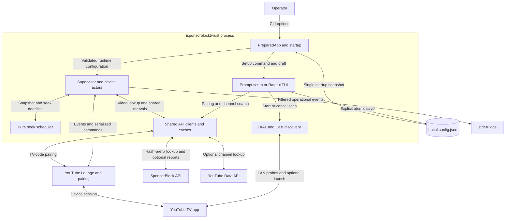

# isponsorblocktvrust Architecture

## Purpose and scope

`isponsorblocktvrust` is a standalone remote-control companion for YouTube TV
apps. It observes playback through YouTube Lounge, fetches SponsorBlock segments,
and sends seek, ad-control, volume, and autoplay commands. It does not download,
modify, or proxy the video stream. No Python runtime is involved.

This document describes the Rust implementation in this directory. Paths below
are relative to it. See [README.md](README.md) for build/release commands,
[GETTING_STARTED.md](GETTING_STARTED.md) for deployment and pairing, and
[AGENTS.md](AGENTS.md) for contributor conventions.

The Cargo package and executable are `isponsorblocktvrust`; the library import
remains `isponsorblocktv`. Windows adds `.exe`. Existing configuration locations,
`iSPBTV_*` environment variables, Lounge `join_name`, and Docker image/service
names remain unchanged. Python entry points and deployment remain separate.

## System boundary and data flow

Playback control travels through Lounge; video delivery remains between YouTube
and the TV. Manual TV-code pairing needs internet access but not LAN discovery.
The YouTube Data API is used for channel whitelist functionality, not ordinary
SponsorBlock skipping. Only explicit setup actions write configuration.

## Composition and ownership

| Component | Responsibility and owned state |
| --- | --- |
| [main.rs](src/main.rs), [cli.rs](src/cli.rs), [lib.rs](src/lib.rs) | CLI dispatch, environment capture, prepared configuration snapshot, process logging and shutdown signals |
| [config.rs](src/config.rs) | Lossless editable document, validated runtime settings, atomic persistence and saved baseline |
| [runtime/mod.rs](src/runtime/mod.rs) | Shared clients/API and supervised device tasks under one shutdown budget |
| [runtime/device.rs](src/runtime/device.rs) | One actor per device: session identity, playback, ad/mute ownership, command queue, timers and child jobs |
| [runtime/scheduler.rs](src/runtime/scheduler.rs) | Pure seek selection and timing from explicit playback/time inputs |
| [lounge/](src/lounge/) | Authentication, availability, sessions, commands, typed events and incremental BrowserChannel decoding |
| [http.rs](src/http.rs), [api/](src/api/) | Transport policies, pairing, metadata, segment processing, bounded caches and shared in-flight lookups |
| [discovery/](src/discovery/) | Coordinator, DIAL/SSDP and Cast/mDNS backends, admission, probes and result stream |
| [setup/](src/setup/) | Prompt I/O and TUI reducer, effects, rendering, terminal lifecycle and setup-time client reuse |

`AppContext` explicitly injects captured environment, endpoints, cancellation,
and optional prompt I/O. `PreparedApp::load(Cli, AppContext)` loads configuration
once and resolves the effective log level. The binary installs its subscriber
before calling `run_app(PreparedApp)`; reusable application code never installs
a global subscriber. Help/version exit through Clap without loading config.

`start` validates the prepared document into `RuntimeConfig`. The supervisor
constructs transports before spawning actors, then shares immutable configuration
and `ApiService`. Each actor alone mutates its device state; child jobs return
results tagged with identity rather than directly changing playback. A slow
receiver does not serialize control of other devices.

`setup` and `setup-cli` instead edit `ConfigDocument`. The TUI uses events → pure
reducer → effects: `state.rs` owns draft and generations, `tui.rs` owns async jobs,
and `widgets.rs` renders state and hit targets.

## Data and persistence

There is no database. Configuration is persisted JSON; protocol sessions,
playback snapshots, caches, discovery results and logs are not written into it.
`--data` selects a directory containing `config.json`, resolved before
`iSPBTV_data_dir` and then platform defaults. Runtime changes require restart.

The following native invariant IDs are retained from the earlier combined
architecture document; they are implementation contracts, not hardware proof.

- **INV-6 — Lossless native drafts:** preserve unknown JSON values,
  arbitrary-precision numbers, and absent/null distinctions. Persistence removes
  only reserved top-level `config_file` and `data_dir` keys. Runtime conversion
  creates a separate model without rewriting the draft.
- **INV-7 — Explicit native persistence:** setup may save incomplete drafts.
  Serialize before creating a same-directory temporary file; preserve existing
  permissions, flush and sync before atomic replacement. Failed saves preserve
  previous contents, live draft and saved baseline. Legacy `atvs` removal is an
  explicit migration action, never automatic.
- **INV-8 — Native startup validation:** validate device IDs, types, finite timing
  values, category sentinels, whitelist credentials, SponsorBlock base URL and
  logging level with redacted field-path errors. Any `atvs` presence blocks
  runtime conversion. Persisted offsets are signed/fractional milliseconds;
  scheduling uses seconds. Missing categories default to sponsor; `[]` disables
  segment fetching. A nonempty whitelist requires a YouTube API key.

Logging preferences are validated during preparation, including setup commands.
Other service-only validation occurs when starting the runtime. Saving a draft
therefore does not certify that it can start the service.

## HTTP, segment processing and caches

- **INV-9 — Native API isolation:** cloud HTTP validates certificates and uses
  proxy environment settings only when enabled. DIAL never uses proxies or
  redirects; accepting self-signed TLS is confined to Cast-local connections.
  Ordinary decoded responses are bounded to 1 MiB, including decompressed bodies,
  with five-second connect and ten-second total deadlines. Lounge subscriptions
  stream without an ordinary total deadline and use actor health timers instead.
  HTTP trace records contain redacted metadata, not payloads or credentials.
- **INV-10 — Native segment correctness:** validate finite intervals, merge
  overlaps and gaps shorter than one second, then apply strict minimum-duration
  filtering. Preserve all distinct UUIDs for reporting. The ten-entry monotonic
  LRU expires unlocked/empty successes at 300 seconds; nonempty all-locked results
  remain until eviction. Failures are not cached. Results use `Arc<[Segment]>`.
  Same-video misses share in-flight work; different videos remain concurrent.
  Cancelling one waiter preserves others; dropping every waiter drops the HTTP
  operation. Failures reach current waiters but do not prevent a later retry.
  Cache/registration locks never cross network awaits. Separate channel-search
  and whitelist LRUs hold ten and one hundred entries respectively.

Segment lookup first respects empty categories and whitelist decisions, then
sends the first four hexadecimal SHA-256 digits of the video ID to SponsorBlock.
The adapter selects the exact video from the returned hash-prefix bucket.
Same-video playback observations retain pending and completed metadata; after
300 seconds, an observation allows an API-cache recheck. A failed fetch can retry
on the next observation. Upcoming videos may be prefetched under session ownership.

## Playback identity, scheduling and commands

Actors own the Lounge token, SID/gsession/AID, command offset, connection epoch,
video epoch, playback revision, playback snapshot, suppression markers and
pending command attempts. Stream readers send connection-tagged events through
a bounded 256-event channel. BrowserChannel frame lengths count UTF-16 units,
not UTF-8 bytes; the decoder validates complete envelopes and bounds buffering.

- **INV-11 — Native work identity:** new connections increment connection and
  video epochs; a changed video ID increments video epoch. Routine observations,
  pause/speed changes and same-video seeks change revision, not video identity.
  Segment results must match epochs and video, not playback revision, and are
  scheduled against the latest snapshot. Unsent schedules are recomputed.
  Dispatched commands retain attempt ID and connection/video identity so an
  observation arriving before HTTP completion cannot suppress valid reporting.
- **INV-12 — Native command ownership:** admit at most 64 queued commands and one
  in-flight command per actor. Consume offsets at dispatch, including failures.
  Session invalidation discards stale queued work. Already-sent commands cannot
  be recalled; ambiguous failed mutations are not blindly replayed.

Only playing wire state `1` with finite positive speed schedules a seek.
Estimated position is `position + elapsed * speed`. Being inside `[start, end)`
is immediately eligible; otherwise the delay is
`max(0, (start - position) / speed - elapsed - offset_seconds)`.
Dispatch revalidates state and eligibility.

A dispatched interval remains suppressed after HTTP completion and routine
observations. Suppression clears when an observed position reaches its end or
video/session identity changes; a later rewind can trigger it again. Failed
seeks report nothing and request fresh state instead of repeating the mutation.
Successful current-identity seeks report captured UUIDs only when tracking is
enabled. Report failures do not retry or reseek. Acceptance of the HTTP request
does not prove that the TV completed the action.

### Advertisements and autoplay

Lounge ad events are independent of SponsorBlock categories and whitelist
bypasses. The actor marks an ad active, invalidates content seeks, optionally
queues Skip Ad when permitted, and independently applies configured muting.
It restores only muting it owns, preserves a user's prior mute, and tracks volume
changes while it owns the mute. Observed content playback or ad-end events clear
the ad state and allow restoration. Autoplay commands are sent only when the
observed mode differs from the configured preference.

Info-level detection is emitted on entry into an observed ad episode, not every
repeated ad event. Leaving the active state emits the end message. Detection
records expose only skip availability and configured skip/mute booleans. Device
numbers are one-based configuration order, not screen IDs.

### Recovery and shutdown

Authentication, availability and connection failures retry on a cancellation-aware
ten-second cadence. Authentication refresh is daily. A ten-second watchdog
reconnects after more than sixty seconds without a decoded event. Unknown SID,
expired auth, malformed framing and dropped streams reset the appropriate state.
Connection-denied identity recovery is attempted once per device process lifetime;
Kids profiles are not sent playback controls.

SIGINT/SIGTERM on Unix or Ctrl+C on Windows cancels the supervisor. All actors
share one three-second shutdown budget: cancel/join child work, attempt connected
session termination, then clear state. At the deadline the supervisor aborts
and joins remaining actors; it does not spend three seconds serially per device.

## Discovery and terminal lifecycles

`DiscoverySession` owns collectors, sockets, probes, cancellation and a bounded
64-event receiver. Drop signals cancellation; explicit `stop` also joins work.
Admission is capped at 256 candidates and eight probes. Active admission lasts
five seconds; each admitted probe has a 45-second deadline including queue time.
Endpoint/UUID deduplication precedes probing; screen-ID deduplication precedes
emission. IDs are bounded to 256 UTF-8 bytes. Session results are additionally
bounded to 256 devices and 64 KiB of retained names/IDs, including deduplication
copies and refreshed candidates. Exhaustion cancels work and emits warning then
completion, including in passive mode.

Active discovery can launch YouTube. Passive discovery queries running apps only,
rate-limits failed reprobes, and continues until cancelled. Opening the TUI's
Add device screen starts active discovery even while the TV-code tab is selected.
Manual `setup-cli` pairing avoids that scan. Cast probes finish after MDX identity
extraction; they are not persistent playback connections.

- **INV-13 — Native LAN confinement:** DIAL URLs must use the responder's literal
  IP without credentials, fragments or redirects. Cast uses admitted resolved
  addresses; derived group endpoints must be unicast on discovered subnets.
  Production rejects loopback/multicast/unspecified destinations. Cast-local
  self-signed TLS encrypts traffic but does not authenticate receiver identity.
- **INV-14 — Native setup result identity:** async results carry screen instance
  and request generation. Input/network-option changes, retry and close/reopen
  invalidate old results; stale pairing cannot authorize a changed code. Effect
  owners cancel/join obsolete jobs and discovery. Only the reducer mutates the
  draft. TUI API clients/caches persist while API-key/proxy settings match and
  are replaced when those settings change.
- **INV-15 — Native terminal restoration:** one Crossterm event stream handles
  keyboard, mouse, paste and resize. A terminal guard restores terminal modes and
  cursor on return/error; owned jobs stop before normal restoration. Below 40×12,
  show a resize-required surface while retaining the draft and allowing Ctrl+C.

The TUI supports explicit save/discard/cancel and preserves drafts on save errors.
Prompt EOF/interruption never saves implicitly. Native prompt workers must be
cancelled and joined even while their input pipe stays open. Noninteractive
terminals use `setup-cli`, not the full-screen interface.

## Logging and privacy

The optional top-level `log_level` accepts exactly `off`, `error`, `warn`, `info`,
`debug`, or `trace`; absence defaults to `info`. Invalid strings/types, including
null, are rejected without echoing the value. `--debug` selects debug for that
run without changing the file; it does not bypass invalid configuration.

The binary installs `off,isponsorblocktv=<level>` after preparation and before
runtime tasks spawn. Third-party targets remain disabled regardless of `RUST_LOG`.
Logs go to stderr. HTTP records additionally require `--http-tracing` and effective
debug/trace verbosity. There is no live log-level reload; restart after editing.
Fatal startup errors remain actionable stderr diagnostics even when logs are off.

Info logs cover service lifecycle, device connections/retries, accepted seeks,
and observed ad transitions. They omit credentials, screen/video IDs and URLs.
Configuration remains sensitive, and redaction is not anonymity: upstreams see
network metadata, whitelist requests carry video IDs/API credentials, and
SponsorBlock viewed reports contain UUIDs. Review output before sharing it.

## Deployment and compatibility

Rust 1.99.1, edition 2024, and the committed Cargo lockfile define the native build.
Native TLS uses SChannel on Windows, Secure Transport on macOS and vendored
OpenSSL on Linux. Host builds still need trust roots; vendoring alone does not
make a binary static or bundle certificates.

[Dockerfile](Dockerfile) uses the parent repository as its build context. Its
Alpine compiler stage selects musl explicitly, enables static CRT linkage,
strips the executable and rejects ELF interpreter/shared-library dependencies.
BuildKit caches Cargo artifacts per architecture. The scratch runtime contains
`/app/isponsorblocktvrust`, CA certificates, license and third-party notices; it
has no shell. [compose.yml](compose.yml) persists `/app/data`, selects the image
through `ISPBTV_RUST_IMAGE`, and uses `restart: unless-stopped`.
[Dockerfile.artifacts](Dockerfile.artifacts) instead packages prebuilt `dist/`
artifacts using this directory as its context.

Published containers target Linux AMD64/ARM64. Raspberry Pi Docker deployment
requires an ARM64-capable Pi with a 64-bit OS; separate ARMv6/ARMv7 release binaries
do not imply 32-bit container support. Native releases also target Linux musl
x86_64/aarch64/i686/ARMv7/ARMv6, Windows MSVC x64 and macOS ARM64/x64.
[scripts/prepare-cross.sh](scripts/prepare-cross.sh) prepares the pinned cross-rs
builder and generated configuration from [Cross.toml](Cross.toml).

[Rust CI](../.github/workflows/rust-ci.yml) configures checks on Linux, Windows
and macOS plus a container smoke test. Release workflows gate publishing on CI
and tag/version agreement. Archives use `isponsorblocktvrust-<version>-<target>`;
image/service names remain `isponsorblocktv-rust`. There is no native self-updater.
Use a dedicated config copy when migrating and only one controller per TV.

**Known deployment risk:** the documented Linux vendored OpenSSL advisory is
not resolved by a passing Rust test suite or a clean RustSec result. Consult the
[dependency security section](README.md#dependency-security) for the affected
version and mitigation status before deployment.

## Verification and operating limits

Built-in Rust/Tokio tests use temporary configuration, loopback HTTP/UDP/TLS,
subprocess isolation and injected endpoints. No production endpoint-override flag
ships in the executable. See [tests and QA](README.md#tests-and-qa) for commands
and the complete suite map.

| Contract | Main proof |
| --- | --- |
| INV-6–8 | `config_contract`: lossless persistence, atomic failure recovery, validation; CLI tests exercise configuration errors |
| INV-9 | `api_contract` and HTTP unit tests: proxy/redirect policy, decoded-body boundary, deadlines and trace redaction |
| INV-10 | `sponsorblock_contract`: merge/filter boundaries, TTL/LRU, same-key sharing, cancellation and failure retry |
| INV-11–12 | `runtime_contract`, scheduler/device unit tests and `lounge_contract`: identities, command ordering, shared-consumer cancellation and common shutdown deadline |
| INV-13 | Discovery/Cast contracts and units: admission, limits, passive/active effects, cancellation and LAN validation |
| INV-14–15 | Setup/TUI/CLI contracts: stale results, client reuse, rendering, explicit saves and native stdin-worker cancellation |
| Logging | Config/CLI contracts: allowed levels, default/override precedence, spawned-task filtering, dependency suppression and HTTP opt-in |
| Composed application | `native_e2e` and `native_scenario`: prepared startup, configuration, loopback device control, reporting, discovery and shutdown |

The recent logging update passed the full Rust suite and strict Clippy on macOS
ARM64; a loopback runtime smoke also verified ad detection/end logs and redaction.
Those results do not establish live API compatibility or physical receiver
behavior. CI platform configuration is not evidence that a remote run passed.

Real terminal lifecycle checks, LAN multicast behavior, Raspberry Pi execution,
and physical TV playback require separate validation. No numeric coverage
threshold, device-count capacity, playback-latency SLA, or hardware-certified
compatibility guarantee is defined. Network/protocol changes can invalidate
assumptions; accepted seek and ad-control requests are not playback acknowledgements.
